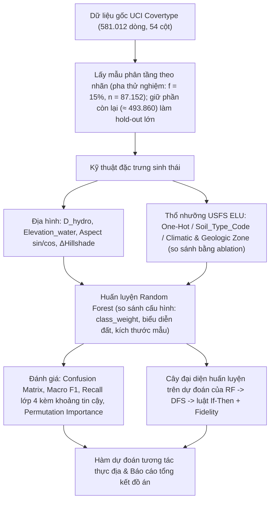

# KẾ HOẠCH TRIỂN KHAI CHI TIẾT
## Đề tài: Phân loại kiểu thảm rừng từ dữ liệu địa hình (Forest Cover Type Classification)

> **Tài liệu tham chiếu liên quan**:
> - [Bối cảnh, Yêu cầu và Mục tiêu đề tài](../01_tong_quan_yeu_cau/BOI_CANH_YEU_CAU_MUC_TIEU.md)
> - [Cơ sở lý thuyết thuật toán Random Forest Classifier](../03_co_so_ly_thuyet/THUAT_TOAN_RANDOM_FOREST.md)
> - [Phương pháp luận trích xuất luật sinh thái](../03_co_so_ly_thuyet/PHUONG_PHAP_TRICH_XUAT_LUAT.md)
> - [Nghiên cứu lý thuyết Lấy mẫu phân tầng & Học nhạy cảm chi phí](../03_co_so_ly_thuyet/CHIEN_LUOC_LAY_MAU_PHAN_TANG.md)
> - [Kỹ thuật tạo đặc trưng sinh thái & Mô hình hóa thổ nhưỡng](../03_co_so_ly_thuyet/KY_THUAT_TAO_DAC_TRUNG_SINH_THAI.md)
> - [Danh mục tài liệu tham khảo & Dẫn chứng khoa học](../04_tai_lieu_tham_khao/TAI_LIEU_THAM_KHAO.md)

---

> **Trạng thái**: thiết kế trước khi thực hiện; mọi con số hiệu năng/thời gian/RAM là **[KỲ VỌNG]**, **[GIẢ THUYẾT]** hoặc **[CẦN ĐO]**. Thiết kế thí nghiệm và quy trình đánh giá: [KE_HOACH_THI_NGHIEM.md](KE_HOACH_THI_NGHIEM.md).
>
> **Cập nhật [SỐ ĐO]**: Bước 1–5 và Bước 5B (cải thiện mô hình, E4–E6) đã chạy trong [`notebooks/Phan_loai_tham_rung.ipynb`](../../notebooks/Phan_loai_tham_rung.ipynb). Cấu hình khởi điểm dưới đây (150 cây, `max_depth=20`, mẫu 15%) là thiết kế ban đầu; mô hình chủ hiện tại cho Bước 6 khác cấu hình này (348.608 mẫu, 150 cây, `max_depth=None`, `criterion='entropy'`, `max_features=0.35`, 26 đặc trưng; xem `models/rf_v2_config.json`).

## 1. KIẾN TRÚC GIẢI PHÁP VÀ PHƯƠNG PHÁP LUẬN KHOA HỌC

### 1.1. Thuật toán cốt lõi: Random Forest Classifier với Học nhạy cảm chi phí
- **Cơ chế hoạt động**:
  - Random Forest `[7]` hoạt động dựa trên nguyên lý **Bagging (Bootstrap Aggregating)** `[6]` kết hợp **Ngẫu nhiên hóa không gian đặc trưng (Feature Randomness)** `[7, 8]`.
  - Thuật toán xây dựng một tập hợp $B = 150$ cây quyết định độc lập. Mỗi cây được huấn luyện trên một tập mẫu lấy có hoàn lại (Bootstrap sample $\approx 63.2\%$ dữ liệu). Tại mỗi nút phân nhánh, chỉ có $m = \lfloor \sqrt{p'} \rfloor$ đặc trưng ngẫu nhiên được khảo sát để tìm điểm cắt tối ưu theo độ vẩn đục Gini `[12]`.
  - Dự đoán cuối cùng là sự đồng thuận biểu quyết theo đa số (Majority Voting) giữa tất cả các cây thành phần `[7]`.
- **Cơ chế trọng số lớp (`class_weight`)**:
  - Dữ liệu bị lệch nghiêm trọng: Lớp 1 và Lớp 2 chiếm $85.22\%$, Lớp 4 chỉ chiếm $0.473\%$ `[1, 3]`.
  - Trọng số nghịch đảo tần suất theo heuristic `'balanced'` của Scikit-learn `[14]`: $w_k = \frac{n}{K \times n_k}$, với $n$ là số mẫu **của tập huấn luyện**.
  - Tỷ số $w_4 / w_2 \approx 103 : 1$ (tính trên tập huấn luyện, xấp xỉ). Kỳ vọng: tăng Recall lớp 4 và Macro F1 **[GIẢ THUYẾT]**; sẽ so sánh với `None` và `balanced_subsample` trong ablation.
  *(Xem chi tiết công thức toán học và cơ chế OOB tại: [THUAT_TOAN_RANDOM_FOREST.md](../03_co_so_ly_thuyet/THUAT_TOAN_RANDOM_FOREST.md))*.

### 1.2. Chiến lược lấy mẫu phân tầng theo tỷ lệ (Proportional Stratified Sampling)
- **Quy mô (pha thử nghiệm)**: $f = 15.0\%$ tương ứng $n = 87.152$ quan sát từ tổng thể $581.012$ mẫu `[1]`. Phần còn lại (≈ $493.860$ mẫu, trong đó ≈ $2.335$ mẫu lớp 4) **không dùng để huấn luyện hay tinh chỉnh**; giữ làm *hold-out lớn* cho đánh giá cuối và làm "bể truy vấn" cho cây đại diện (mục 1.4).
- **Cơ sở**: phân tầng theo nhãn bảo toàn tỷ lệ 7 lớp ở cả tập huấn luyện và kiểm thử (`stratify=y`), tránh lệch ngẫu nhiên ở lớp hiếm. Lưu ý: định lý phương sai của Cochran (1977) `[13]` nói về *ước lượng trung bình*, không bảo đảm mô hình tốt hơn; phạm vi áp dụng được làm rõ trong `CHIEN_LUOC_LAY_MAU_PHAN_TANG.md`.
- **Chi phí tính toán** (RAM, thời gian huấn luyện): **[CẦN ĐO]**. Kích thước mẫu cho mô hình cuối chọn bằng learning curve (15% → 100%), vì mẫu 15% có thể làm giảm hiệu năng so với dùng toàn bộ dữ liệu.
  *(Xem chi tiết tại: [CHIEN_LUOC_LAY_MAU_PHAN_TANG.md](../03_co_so_ly_thuyet/CHIEN_LUOC_LAY_MAU_PHAN_TANG.md))*.

### 1.3. Kỹ thuật tạo đặc trưng sinh thái và Mô hình hóa thổ nhưỡng
Các đặc trưng dưới đây là **đề xuất**; giá trị của từng nhóm được kiểm chứng bằng ablation `[KE_HOACH_THI_NGHIEM.md]`:
1. **Khoảng cách không gian 3 chiều tới nguồn nước**:
   $$D_{\text{hydro}} = \sqrt{\text{Horizontal\_Distance}^2 + \text{Vertical\_Distance}^2}$$
   Cây CART chỉ cắt theo trục, nên khoảng cách tổng hợp giúp tách "hành lang ven suối" bằng 1 điểm cắt.
2. **Cao độ tuyệt đối của nguồn nước mặt gần nhất**:
   $$\text{Elevation}_{\text{water}} = \text{Elevation} - \text{Vertical\_Distance\_To\_Hydrology}$$
   Là cao độ của *nguồn nước mặt gần nhất* (không phải mực nước ngầm); đóng vai trò chỉ báo vị trí thung lũng/đáy sườn. Quy ước dấu của `Vertical_Distance_To_Hydrology` cần kiểm tra ở EDA.
3. **Biến đổi lượng giác hướng sườn**:
   $$\text{Aspect}_{\cos} = \cos\left(\frac{2\pi \times \text{Aspect}}{360}\right), \quad \text{Aspect}_{\sin} = \sin\left(\frac{2\pi \times \text{Aspect}}{360}\right)$$
   Xử lý tính tuần hoàn của góc (0° ≡ 360°); phân định hướng Bắc–Nam (cos) và Đông–Tây (sin) `[5]`. Cây quyết định có thể xấp xỉ bằng 2 điểm cắt, nên lợi ích thực tế cần đo.
4. **ΔHillshade** (đề xuất định nghĩa): $\Delta\text{Hillshade} = \text{Hillshade\_3pm} - \text{Hillshade\_9am}$, chỉ báo bất đối xứng bức xạ chiều/sáng.
5. **Biểu diễn thổ nhưỡng — 3 phương án so sánh**:
   - (A) One-Hot nguyên bản (40 cột).
   - (B) `Soil_Type_Code` $\in \{1,\dots,40\}$ (1 cột số nguyên). Lưu ý: cây coi mã là biến thứ tự; thứ tự 1–40 gần như tăng theo đai ELU nhưng không hoàn toàn, nên (B) có thể tốt hơn hoặc kém hơn (A).
   - (C) `Soil_Climatic_Zone` (1–8) và `Soil_Geologic_Zone` (1–8) giải mã từ mã ELU 4 chữ số.
   Số cột: phương án (B) có 15 cột trước khi thêm đặc trưng ở mục 1–4; sau đó khoảng 20–22 cột (tuỳ giữ/bỏ `Aspect` gốc và thêm Zone).
  *(Xem chi tiết tại: [KY_THUAT_TAO_DAC_TRUNG_SINH_THAI.md](../03_co_so_ly_thuyet/KY_THUAT_TAO_DAC_TRUNG_SINH_THAI.md))*.

### 1.4. Phương pháp luận trích xuất "Luật sinh thái rừng"
- Huấn luyện Cây quyết định độ sâu hạn chế (`max_depth = 5`, `min_samples_leaf = 150`) làm **mô hình đại diện (surrogate)** `[11, 12]`. Cây được huấn luyện trên **dự đoán của Random Forest** (không phải nhãn thật) để xấp xỉ hàm quyết định của RF; dữ liệu truy vấn RF lấy từ phần 85% chưa dùng huấn luyện (RF dự đoán lại chính tập huấn luyện thường gần trùng nhãn thật nên không phản ánh hành vi của RF).
- Áp dụng DFS trên cấu trúc Scikit-learn `tree_` để xuất chuỗi mệnh đề $\bigwedge (X_j \text{ op } \theta_j) \implies \text{Class } C_k$.
- Định lượng từng luật bằng **đếm trên mẫu thực** (không dùng `tree_.value` vì giá trị này bị nhân trọng số lớp): $Confidence$, $Support$, $Class\ coverage$, $Lift$, và $Fidelity$ so với RF.
- Sàng lọc và ánh xạ ngữ nghĩa thành bảng **Top Quy tắc vàng If-Then** đối chiếu với các đai cao độ của Peet (1981) `[4]` và Marr (1961) `[5]`; luật mô tả tương quan, không khẳng định quan hệ nhân quả.
  *(Xem chi tiết tại: [PHUONG_PHAP_TRICH_XUAT_LUAT.md](../03_co_so_ly_thuyet/PHUONG_PHAP_TRICH_XUAT_LUAT.md))*.

---

## 2. KẾ HOẠCH TRIỂN KHAI CHI TIẾT 8 BƯỚC (STEP-BY-STEP WORKFLOW)

| Bước | Tên giai đoạn | Nội dung kỹ thuật chi tiết | Công cụ / Module sử dụng | Đầu ra kỳ vọng (Deliverables) |
| :---: | :--- | :--- | :--- | :--- |
| **Bước 1** | **Khởi tạo môi trường & Nạp dữ liệu** | - Nạp `data/raw/covtype.data` (hoặc `.gz`); nếu không có thì tải bằng `sklearn.datasets.fetch_covtype()` (đã đối chiếu trùng khớp với file UCI). - Thẩm tra toàn vẹn: $581.012$ dòng $\times$ $55$ cột, $0$ giá trị thiếu; đối chiếu số lượng từng lớp với bảng 7 lớp. - Ép kiểu (`float32`/`uint8`) để giảm RAM; ghi lại phiên bản thư viện và đặt `random_state`. | `pandas`, `sklearn.datasets` | DataFrame gốc, kích thước $581.012 \times 55$; log phiên bản môi trường. |
| **Bước 2** | **Phân tích khám phá dữ liệu (EDA)** | - Thống kê tần suất 7 kiểu thảm rừng, minh chứng mất cân bằng $85.22\%$ vs. $0.473\%$. - Boxplot `Elevation` theo từng kiểu rừng; **ngưỡng độ cao dùng trong luật lấy từ dữ liệu này**, đối chiếu đai cao Peet `[4]`. - Kiểm tra quy ước dấu của `Vertical_Distance_To_Hydrology`. - Biểu đồ nhiệt tương quan địa hình – bức xạ – khoảng cách nước. | `matplotlib`, `seaborn` | Biểu đồ phân tầng sinh thái; xác nhận các giả định về dữ liệu. |
| **Bước 3** | **Lấy mẫu phân tầng & Kỹ thuật đặc trưng** | - Lấy mẫu phân tầng $f = 15\%$ ($n = 87.152$) cho pha thử nghiệm; giữ phần còn lại làm hold-out lớn. - Chia Train ($80\%$) / Test ($20\%$) có `stratify=y`; **tính trọng số lớp chỉ trên Train**. - Tạo đặc trưng theo mục 1.3 (gồm định nghĩa $\Delta\text{Hillshade}$) và các biểu diễn đất (A)/(B)/(C). - Áp dụng **cùng một hàm biến đổi** cho Train, Test, hold-out và hàm tương tác ở Bước 7. | `train_test_split(..., stratify=y)`, `numpy` | Bộ dữ liệu theo từng cấu hình ablation, bảo toàn tỷ lệ lớp. |
| **Bước 4** | **Huấn luyện Random Forest & Ablation** | - Cấu hình khởi điểm: `n_estimators=150`, `max_depth=20`, `class_weight='balanced'`, `n_jobs=-1`, `random_state=42` (**[CẦN TINH CHỈNH]**, không phải giá trị tối ưu đã chứng minh). - Chạy các cấu hình ablation (trọng số lớp, biểu diễn đất, đặc trưng sinh thái, kích thước mẫu) theo `KE_HOACH_THI_NGHIEM.md`, lặp nhiều seed. - Ghi thời gian huấn luyện và RAM thực tế. | `RandomForestClassifier` (Scikit-learn) `[7, 14]` | Bảng kết quả ablation; cấu hình được chọn kèm bằng chứng. |
| **Bước 5** | **Đánh giá hiệu năng toàn diện** | - Đánh giá trên Test ($n_{\text{test}} \approx 17.431$) **và** trên hold-out lớn (≈ $493.860$). - Báo cáo Accuracy, Macro/Weighted F1, Precision, Recall từng lớp; **Recall lớp 4 kèm khoảng tin cậy** (Test chỉ có ≈ 82 mẫu lớp 4). - Ma trận nhầm lẫn gắn nhãn 7 loài cây. - Tầm quan trọng đặc trưng: Gini **và Permutation Importance** `[15]`. | `classification_report`, `confusion_matrix`, `permutation_importance` | Số đo thực tế thay cho các **[KỲ VỌNG]**: Accuracy ≥ 88%, Macro F1 ≥ 0.78, Recall lớp 4 ≥ 75% (ngưỡng tối thiểu). |
| **Bước 6** | **Khai phá & Trích xuất Luật sinh thái rừng** | - Huấn luyện cây đại diện (`max_depth=5`) **trên dự đoán của RF** truy vấn từ phần dữ liệu chưa dùng huấn luyện (D_val của Bước 5B, `idx_val` trong `models/splits_v2.npz`); đo Fidelity trên D_final (`idx_final`). - DFS trích xuất đường đi gốc → lá. - Đo $Confidence$, $Support$, $Class\ coverage$, $Lift$, $Fidelity$ bằng đếm trên mẫu thực. - Báo cáo Fidelity toàn cục của cây so với RF; lọc và xuất bảng **Top Quy tắc vàng**; vẽ cây bằng `plot_tree`. | `DecisionTreeClassifier`, `plot_tree`, hàm `trich_xuat_luat` | Bảng quy tắc vàng kèm Fidelity; nêu rõ mức độ cây xấp xỉ RF. |
| **Bước 7** | **Xây dựng Hàm tương tác thực địa** | - Hàm `du_doan_kieu_rung(...)` nhận Độ cao, hướng sườn, khoảng cách nước, loại đất…; **kiểm tra đầu vào** (loại đất 1–40, khu vực 1–4, khoảng giá trị hợp lệ). - Áp dụng đúng pipeline đặc trưng như Bước 3; trả về lớp dự đoán, xác suất, và luật kích hoạt bằng `decision_path` của cây đại diện (nêu rõ khi dự đoán RF và luật cây khác nhau). - Thử nghiệm với vài kịch bản giả định. | Python Widget / Interactive CLI | Công cụ hỗ trợ tương tác, có kiểm tra đầu vào. |
| **Bước 8** | **Đóng gói Notebook Colab & Báo cáo tổng kết** | - Nút 1-click **"Open In Colab"**; kiểm tra chạy "Run All" từ đầu. - Thay toàn bộ **[KỲ VỌNG]** trong `docs/` bằng số đo thực tế; cập nhật `CHANGELOG_RA_SOAT.md`. | Jupyter Notebook, Markdown | `notebooks/Phan_loai_tham_rung.ipynb` chạy được trên Colab và bộ tài liệu khớp với kết quả thật. |

---

## 3. HẠN CHẾ VÀ RỦI RO ĐÃ BIẾT

- **Tự tương quan không gian và dịch chuyển giữa vùng**: các ô 30 m lân cận rất giống nhau, nên chia ngẫu nhiên có thể cho kết quả lạc quan hơn so với áp dụng ở vùng mới `[16]`. Dữ liệu UCI không có toạ độ; thí nghiệm leave-one-wilderness-out là phép kiểm tra thay thế, có giới hạn. **[SỐ ĐO]** E6 (Macro-F1 trên các lớp đã thấy, trung bình 4 vùng): v2 giảm từ 0,970 (chia ngẫu nhiên, D_final cùng vùng) xuống 0,323 (vùng chưa thấy); mô hình Bước 4.7 giảm từ 0,858 xuống 0,316. Luật trích xuất ở Bước 6 vì vậy cần được trình bày là mô tả trong phạm vi 4 vùng nghiên cứu.
- **Lớp 4 rất ít mẫu**: ≈ 82 mẫu trong Test 20% của mẫu 15%; Recall lớp 4 có độ bất định lớn, cần khoảng tin cậy và hold-out lớn.
- **Luật chỉ là xấp xỉ**: cây đại diện nông không tái hiện đầy đủ RF; phải báo cáo Fidelity. Luật mô tả tương quan, không phải quan hệ nhân quả.
- **Ngưỡng sinh thái từ văn liệu** là số làm tròn theo các đai của Peet (1981) và Marr (1961) (đã xác minh), có sự chồng lấn tự nhiên; ngưỡng quyết định phân lớp cuối cùng lấy từ dữ liệu thực tế.
- **Chi phí tính toán**: trên Colab **[CẦN ĐO]**. **[SỐ ĐO]** trên máy cục bộ 24 lõi CPU / 16 GB RAM: toàn bộ notebook ≈ 48 phút; Colab miễn phí có ít lõi hơn nên dự kiến lâu hơn đáng kể.
