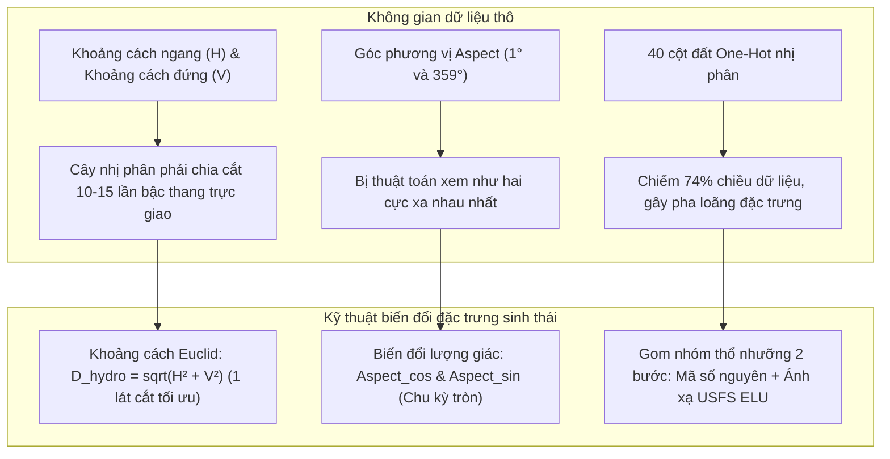

# NGHIÊN CỨU LÝ THUYẾT VÀ PHƯƠNG PHÁP LUẬN: KỸ THUẬT TẠO ĐẶC TRƯNG SINH THÁI VÀ MÔ HÌNH HÓA THỔ NHƯỠNG
## Theoretical Foundations of Ecological Feature Engineering and Soil Taxonomy Modeling in Forest Cover Type Classification

> **Tài liệu tham chiếu liên quan**:
> - [Bối cảnh, Yêu cầu và Mục tiêu đề tài](../01_tong_quan_yeu_cau/BOI_CANH_YEU_CAU_MUC_TIEU.md)
> - [Kế hoạch triển khai kỹ thuật](../02_ke_hoach_va_kien_truc/KE_HOACH_TRIEN_KHAI.md)
> - [Cơ sở lý thuyết thuật toán Random Forest](THUAT_TOAN_RANDOM_FOREST.md)
> - [Phương pháp trích xuất luật sinh thái](PHUONG_PHAP_TRICH_XUAT_LUAT.md)
> - [Lý thuyết Lấy mẫu phân tầng](CHIEN_LUOC_LAY_MAU_PHAN_TANG.md)
> - [Danh mục tài liệu tham khảo & Dẫn chứng khoa học](../04_tai_lieu_tham_khao/TAI_LIEU_THAM_KHAO.md)

---

> **Trạng thái**: thiết kế trước khi thực hiện. Các lợi ích của từng đặc trưng/biểu diễn nêu dưới đây là **[GIẢ THUYẾT]**, được kiểm chứng bằng ablation (`../02_ke_hoach_va_kien_truc/KE_HOACH_THI_NGHIEM.md`).

## 1. ĐẶT VẤN ĐỀ VÀ TÍNH TẤT YẾU CỦA KỸ THUẬT ĐẶC TRƯNG (FEATURE ENGINEERING)

Trong mô hình hóa học máy, giả định rằng thuật toán có thể tự động khai phá toàn bộ các mối quan hệ phi tuyến phức tạp từ dữ liệu thô thường dẫn đến sự suy giảm hiệu năng khi cấu trúc biểu diễn dữ liệu không tương thích với thiên hướng quy nạp (Inductive Bias) của giải thuật `[7, 12]`.

Bộ dữ liệu **Forest Covertype (UCI ID 31)** `[1]` chứa 54 thuộc tính trắc địa thô thu thập tại Rừng quốc gia Roosevelt (Roosevelt National Forest), Colorado `[2, 3]`. Mặc dù phản ánh các yếu tố cảnh quan tự nhiên, cấu trúc biểu diễn số học nguyên bản của bộ dữ liệu có ba hạn chế tiềm tàng đối với mô hình dựa trên cây:
1. **Sự không tương thích hình học giữa mặt phân chia trực giao (Axis-aligned Splits) của cây quyết định và khoảng cách không gian 3 chiều thực tế.**
2. **Nghịch lý dữ liệu tuần hoàn (Circular / Directional Data) đối với biến số góc phương vị la bàn.**
3. **Hiện tượng phân mảnh dữ liệu (Data Fragmentation) và pha loãng không gian con ngẫu nhiên (Subspace Dilution) do 40 biến nhị phân One-Hot biểu diễn loại đất gây ra.**

Kỹ thuật tạo đặc trưng sinh thái (Ecological Feature Engineering) đóng vai trò chuyển hóa các đại lượng trắc địa thuần túy thành các chỉ số sinh thái - vật lý thực nghiệm, tối ưu hóa quá trình phân nhánh của cây quyết định và tạo nền tảng cho việc trích xuất tri thức tường minh `[11]`.

---

## 2. PHÂN TÍCH GIỚI HẠN HÌNH HỌC VÀ CÁC BIẾN ĐỔI KHÔNG GIAN ĐỊA HÌNH



### 2.1. Tối ưu hóa khoảng cách thủy văn 3 chiều (Euclidean Hydrologic Distance)
Trong dữ liệu gốc `[1]`, yếu tố thủy văn bị chia tách thành hai trục độc lập:
- $H$: Khoảng cách nằm ngang tới nguồn nước mặt (`Horizontal_Distance_To_Hydrology`).
- $V$: Độ chênh lệch cao độ đứng so với nguồn nước (`Vertical_Distance_To_Hydrology`).

Cây quyết định CART `[12]` chỉ phân nhánh dựa trên các siêu phẳng song song với trục tọa độ ($x_j \le \theta$). Môi trường sinh trưởng của hệ rễ thực vật phụ thuộc vào khoảng cách không gian thực tế tới nguồn nước mặt theo đường chéo trong không gian $\mathbb{R}^3$. Nếu không có biến đổi, cây quyết định phải xấp xỉ một đường cong đẳng khoảng cách bằng một chuỗi gián đoạn hình bậc thang (Staircase approximation), có thể làm tăng độ sâu của cây và nguy cơ quá khớp (Overfitting).

Đặc trưng khoảng cách Euclid được thiết lập nhằm tuyến tính hóa bề mặt quyết định:

$$D_{\text{hydro}} = \sqrt{H^2 + V^2}$$

Đặc trưng này cho phép thuật toán phân lập hành lang ẩm ven suối (Riparian corridor) chỉ qua một điều kiện phân nhánh đơn lẻ: $D_{\text{hydro}} \le \theta_{\text{hydro}}$.

### 2.2. Cao độ tuyệt đối của nguồn nước mặt gần nhất (Absolute Water-Feature Elevation)
Biến $V$ (`Vertical_Distance_To_Hydrology`) là chênh lệch cao độ *tương đối* giữa điểm đo và nguồn nước mặt gần nhất (suối, hồ, …), không phải mực nước ngầm. Đặc trưng cao độ tuyệt đối của nguồn nước đó:

$$\text{Elevation}_{\text{water}} = \text{Elevation} - V$$

(giả định quy ước dấu của UCI; **cần kiểm tra ở EDA**). Chỉ báo này có thể giúp phân biệt nguồn nước ở đáy thung lũng thấp với nguồn nước ở đai cao, từ đó hỗ trợ tách các sinh cảnh ven suối đai thấp (ví dụ Lớp 4 *Cottonwood/Willow*) khỏi các sinh cảnh đai cao (ví dụ Lớp 7 *Krummholz*) `[4, 5]`. Giá trị thực tế của đặc trưng là **[GIẢ THUYẾT]**.

### 2.3. Giải quyết nghịch lý dữ liệu góc phương vị tuần hoàn (Aspect Trigonometric Transformation)
Hướng sườn núi (`Aspect`) được đo đạc theo độ phương vị la bàn $\theta \in [0^\circ, 360^\circ)$.

Về mặt vật lý học cảnh quan `[5]`, sườn núi hướng $1^\circ$ (Bắc - Đông Bắc) và $359^\circ$ (Bắc - Tây Bắc) nhận lượng bức xạ mặt trời tương đương nhau và cùng chịu ảnh hưởng của các đợt gió lạnh phương Bắc. Tuy nhiên, trên trục số thực $\mathbb{R}$, khoảng cách số học giữa hai điểm này là cực đại ($|359 - 1| = 358$). Các thuật toán quy nạp cây sẽ xử lý hai hướng này như hai trạng thái sinh thái đối lập.

Để bảo toàn tính chất topo liên tục của hình tròn $S^1$, biến `Aspect` được ánh xạ thành hai thành phần trực giao thông qua biến đổi lượng giác:

$$\text{Aspect}_{\cos} = \cos\left(\frac{2\pi \times \text{Aspect}}{360}\right), \quad \text{Aspect}_{\sin} = \sin\left(\frac{2\pi \times \text{Aspect}}{360}\right)$$

- **$\text{Aspect}_{\cos} \in [-1, 1]$ (Trục Bắc – Nam / Chỉ số bức xạ nhiệt)**: Đại diện cho gradien nhiệt độ. $\text{Aspect}_{\cos} \to 1$ đại diện cho sườn đón gió lạnh phía Bắc (nơi cư ngụ của Vân sam và Linh sam); $\text{Aspect}_{\cos} \to -1$ đại diện cho sườn khô nóng hướng Nam (sinh cảnh đặc trưng của Thông Ponderosa) `[4]`.
- **$\text{Aspect}_{\sin} \in [-1, 1]$ (Trục Đông – Tây / Chỉ số phân bổ quang năng)**: Phân định giữa sườn hướng Đông đón nắng sớm dịu và sườn hướng Tây chịu bức xạ chiều gay gắt.

---

> **Ghi chú về Aspect**: cây quyết định có thể xấp xỉ tính tuần hoàn của góc bằng hai điểm cắt, nên mức "nghịch lý" nêu trên có thể nhỏ hơn mô tả; lợi ích của sin/cos được đo bằng ablation. Có thể giữ hoặc bỏ `Aspect` gốc.

### 2.4. Các đặc trưng bổ sung (đề xuất, tuỳ chọn)
- $\Delta\text{Hillshade} = \text{Hillshade\_3pm} - \text{Hillshade\_9am}$ (chỉ báo bất đối xứng bức xạ chiều/sáng; **định nghĩa đề xuất**, cần xác nhận).
- Tổ hợp tuyến tính của các khoảng cách (cộng/trừ giữa `Horizontal_Distance_To_Hydrology`, `..._Roadways`, `..._Fire_Points`) là các biến thường được thử với dữ liệu này; chỉ giữ lại nếu ablation cho thấy cải thiện.

---

## 3. CƠ SỞ LÝ THUYẾT VỀ GOM NHÓM THỔ NHƯỠNG (SOIL TAXONOMY GROUPING)

### 3.1. Hạn chế toán học của biểu diễn One-Hot trên không gian đặc trưng
Trong bộ dữ liệu Covertype nguyên bản `[1]`, 40 loại đất được mã hóa nhị phân thành 40 cột (`Soil_Type1` đến `Soil_Type40`). Đây là dạng biểu diễn One-Hot (mỗi mẫu chỉ có đúng một giá trị 1 và 39 giá trị 0). Dạng biểu diễn này chiếm tới $\frac{40}{54} \approx 74.07\%$ tổng số chiều đặc trưng, tạo thành một ma trận thưa với tỷ lệ giá trị 0 đạt $97.5\%$.

#### A. Giả thuyết pha loãng không gian con ngẫu nhiên (Feature Subspace Dilution)
Trong thuật toán Random Forest `[7]`, tại mỗi nút phân nhánh, một tập con gồm $m$ đặc trưng được chọn ngẫu nhiên không hoàn lại từ tổng số $p$ đặc trưng:

$$m = \lfloor \sqrt{p} \rfloor = \lfloor \sqrt{54} \rfloor = 7$$

Xác suất để một tập con ngẫu nhiên chứa đúng $k$ đặc trưng thuộc nhóm thổ nhưỡng tuân theo phân phối siêu bội (Hypergeometric Distribution):

$$P(X = k) = \frac{\binom{40}{k} \binom{14}{7-k}}{\binom{54}{7}}$$

Kỳ vọng số lượng biến đất rơi vào tập con lựa chọn tại mỗi nút là:

$$\mathbb{E}[X] = m \times \frac{40}{54} = 7 \times 0.7407 \approx 5.18 \text{ đặc trưng}$$

Xác suất để một tập ứng viên có ít nhất 5 biến đất (chỉ còn tối đa 2 biến không phải đất) là:

$$P(X \ge 5) = \sum_{k=5}^{7} \frac{\binom{40}{k} \binom{14}{7-k}}{\binom{54}{7}} \approx \mathbf{74.7\%}$$

(với $P(X=5) \approx 33.8\%$, $P(X=6) \approx 30.3\%$, $P(X=7) \approx 10.5\%$).

> **Diễn giải đúng mức**:
> - Đây chỉ là xác suất về *thành phần tập ứng viên*. Mỗi nút vẫn xét 7 ứng viên, và xác suất để một đặc trưng cụ thể (ví dụ `Elevation`) có mặt tại một nút là $m/p = 7/54 \approx 13.0\%$ như mọi đặc trưng khác. Cây vẫn có thể chọn `Elevation` ở nhiều nút khác.
> - Nếu giảm xuống $p' \approx 22$ đặc trưng với $m' = \lfloor\sqrt{22}\rfloor = 4$, xác suất đó là $4/22 \approx 18.2\%$ (tăng khoảng 1.4 lần). Có thể cải thiện cạnh tranh giữa các biến địa hình, nhưng **mức tác động lên hiệu năng chưa được chứng minh** và có thể nhỏ.
> - Vì vậy dự án so sánh One-Hot với các biểu diễn gọn hơn bằng ablation thay vì giả định kết luận trước.

#### B. Phân mảnh dữ liệu qua các lát cắt nhị phân bất đối xứng (Asymmetric Binary Splits)
Khi một cây quyết định phân nhánh trên một biến nhị phân One-Hot hiếm (ví dụ: $\text{Soil\_Type}_j \le 0.5$ với một loại đất chỉ chiếm vài phần trăm số mẫu, như $\approx 4\%$ — con số minh hoạ):
- Nhánh $= 0$ giữ lại phần lớn mẫu; nhánh $= 1$ chỉ chứa một phần nhỏ (lát cắt bất đối xứng).

Để cô lập các loại đất khác, thuật toán buộc phải tạo ra một chuỗi phân nhánh bậc thang lệch (Degenerate Staircase Tree) `[12]`. Cấu trúc cây bị kéo sâu một cách nhân tạo, lãng phí tham số `max_depth` mà không tối ưu hóa được độ tinh khiết Gini.

---

### 3.2. Phương pháp luận hai giai đoạn trong Gom nhóm thổ nhưỡng

Để giảm các hạn chế trên, nghiên cứu thiết lập quy trình xử lý thổ nhưỡng hai giai đoạn:

```
[40 Biến One-Hot thưa thớt]
            │
            ▼  (Giai đoạn 1: Biến đổi Vector-to-Scalar)
[1 Cột định danh số nguyên: Soil_Type_Code ∈ {1, 2, ..., 40}]
            │
            ▼  (Giai đoạn 2: Ánh xạ ngữ nghĩa sinh thái USFS ELU)
[Đặc trưng Đai khí hậu thổ nhưỡng (Climatic Zone) & Đá mẹ địa chất (Geologic Zone)]
```

#### Giai đoạn 1: Biến đổi Vector-to-Scalar (Inverse One-Hot Encoding)
Mỗi vector nhị phân đại diện cho thổ nhưỡng $\mathbf{s}_i = [s_{i,1}, s_{i,2}, \dots, s_{i,40}] \in \{0, 1\}^{40}$ (với $\|\mathbf{s}_i\|_1 = 1$) được rút gọn thành một đại lượng vô hướng định danh duy nhất:

$$\text{Soil\_Type\_Code}_i = \arg\max_{j \in \{1, \dots, 40\}} s_{i,j} \in \{1, 2, \dots, 40\}$$

Sau phép biến đổi này:
- Tổng số chiều giảm từ $p = 54$ xuống $p' = 15$ cột (trước khi thêm các đặc trưng ở mục 2; sau đó khoảng 20–22 cột).
- Số biến khảo sát tại mỗi nút theo `max_features='sqrt'`: $m' = \lfloor \sqrt{15} \rfloor = 3$ (hoặc $4$ khi $p' \approx 22$).
- Tỷ trọng cột đất trong không gian đặc trưng giảm từ $74.07\%$ xuống $\frac{1}{15} \approx 6.67\%$ (các biến không phải đất chiếm $14/15 \approx 93.33\%$ số cột).

> **Lưu ý khi dùng mã số nguyên**: cây quyết định coi `Soil_Type_Code` là biến *thứ tự*, nên các điểm cắt kiểu $\text{code} \le 17$ gộp các loại đất theo thứ tự 1–40. Thứ tự này gần như tăng theo đai ELU nên có ý nghĩa một phần, nhưng không hoàn toàn. Vì vậy (B) `Soil_Type_Code` có thể tốt hơn hoặc kém hơn One-Hot; cần so sánh với (A) One-Hot và (C) `Soil_Climatic_Zone` + `Soil_Geologic_Zone`.

#### Giai đoạn 2: Ánh xạ ngữ nghĩa sinh thái học theo hệ thống USFS ELU
Theo tài liệu chính thức `data/raw/covtype.info` `[1]`, 40 mã đất được xây dựng trên cơ sở phân loại **Đơn vị đất sinh thái (Ecological Landtype Units - ELUs)** của Cục Kiểm lâm Hoa Kỳ `[2]`. Mỗi mã đất tương ứng với một mã ELU gồm 4 chữ số:

$$\text{ELU} = d_1 d_2 d_3 d_4$$

Trong đó, hai chữ số đầu mang ý nghĩa sinh thái học cảnh quan sâu sắc `[1, 2]`:
1. **Chữ số thứ nhất ($d_1 \in \{1, \dots, 8\}$) - Đai khí hậu thổ nhưỡng (Climatic Zone)** (**Đã xác minh**: khớp chính xác định nghĩa trong `covtype.info` `[1]`):
   - $d_1 = 1$: Lower montane dry (lưu ý: không có loại đất nào trong 40 mã của bộ dữ liệu thuộc đai này)
   - $d_1 = 2$: Lower montane
   - $d_1 = 3$: Montane dry
   - $d_1 = 4$: Montane
   - $d_1 = 5$: Montane dry and montane
   - $d_1 = 6$: Montane and subalpine (đai chuyển tiếp)
   - $d_1 = 7$: Subalpine
   - $d_1 = 8$: Alpine — sinh cảnh gắn liền với thảm thực vật ranh giới băng tuyết và cây bụi lùn *Krummholz* `[4, 5]`.
2. **Chữ số thứ hai ($d_2 \in \{1, \dots, 8\}$) - Nguồn gốc đá mẹ địa chất (Geologic Zone)** (**Đã xác minh**: khớp chính xác định nghĩa trong `covtype.info`):
   - Hệ thống USFS quy định: $1$: Alluvium; $2$: Glacial; $3$: Shale; $4$: Sandstone; $5$: Mixed sedimentary; $6$: Unspecified; $7$: Igneous and metamorphic; $8$: Volcanic.
   - *Lưu ý thực tế trên bộ dữ liệu*: 40 mã đất của Rừng quốc gia Roosevelt chỉ xuất hiện 4 nhóm đá mẹ: $d_2 \in \{1, 2, 5, 7\}$ (Alluvium, Glacial, Mixed sedimentary, Igneous/Metamorphic); các nhóm 3, 4, 6, 8 không có mẫu đại diện trong tập dữ liệu này.

Nghiên cứu xây dựng hàm ánh xạ ngữ nghĩa $f_{\text{ELU}}: \{1, \dots, 40\} \to \mathbb{N}^2$:

$$f_{\text{ELU}}(\text{Soil\_Type\_Code}) = \left( d_1, d_2 \right) = \left( \text{Soil\_Climatic\_Zone}, \text{Soil\_Geologic\_Zone} \right)$$

---

## 4. BẢNG ĐỐI CHIẾU ÁNH XẠ THỔ NHƯỠNG THEO HỆ THỐNG USFS ELU

Dưới đây là ma trận ánh xạ chuẩn hóa toàn bộ 40 loại đất `data/raw/covtype.info` `[1]`**:

| Mã nghiên cứu (1–40) | Mã USFS ELU `[1]` | Đai khí hậu ($d_1$) | Đá mẹ địa chất ($d_2$) | Phân loại đất và tính chất hình thái học (theo `covtype.info`) |
| :---: | :---: | :---: | :---: | :--- |
| **1 – 6** | 2702 – 2717 | 2 (Lower montane) | 7 (Igneous/Metamorphic) | Quần hợp đất đá sỏi Cathedral/Vanet/Ratake/Haploborolis/Wetmore, nhiều đá lộ đầu (*Rock outcrop complex*). |
| **7 – 8** | 3501 – 3502 | 3 (Montane dry) | 5 (Mixed sedimentary) | Đất Gothic / Supervisor - Limber families complex trên đá trầm tích hỗn hợp, khô hạn. |
| **9 – 13** | 4201 – 4758 | 4 (Montane) | 2, 7 (Glacial / Igneous) | Đất Troutville (Mã 9, trầm tích băng hà Glacial); Bullwark/Catamount/Legault (Mã 10–13, đá mắc-ma/biến chất), nhiều đá sỏi sườn dốc. |
| **14 – 15** | 5101 – 5151 | 5 (Montane dry/montane)| 1 (Alluvium) | Đất bồi tích ven suối Pachic Argiborolis - Aquolis complex (Mã 14); Mã 15 là *unspecified in the USFS Soil and ELU Survey* (nhưng mang tiền tố ELU 5151). |
| **16 – 18** | 6101 – 6731 | 6 (Montane/subalpine) | 1, 7 (Alluvium / Igneous) | Phức hợp bồi tích Cryaquolis/Gateview (Mã 16, 17, $d_2=1$); Đất Rogert đá mắc-ma (Mã 18, $d_2=7$), đai chuyển tiếp cận tuyết. |
| **19 – 34** | 7101 – 7790 | **7 (Subalpine)** | 1, 2, 7 (Alluvium/Glacial/Igneous)| **Họ đất Leighcan/Como/Catamount/Cryorthents**: Gồm đất bồi tích Cryaquolls (19–21, $d_2=1$), đất băng tích Till (22–23, $d_2=2$), và đất sỏi đá tảng núi cao (24–34, $d_2=7$). |
| **35 – 40** | 8703 – 8776 | **8 (Alpine)** | 7 (Igneous/Metamorphic) | **Phức hợp Cryumbrepts/Bross/Moran/Cryorthents**: Đất đá vụn, sỏi đá lộ đầu ranh giới băng tuyết (*Timberline/Alpine*). |

---

> **Ghi chú về bảng**: Cột "Phân loại đất và tính chất hình thái học" đã được **đối chiếu và chuẩn hóa trực tiếp từ `covtype.info`**. Hai cột mã ELU, $d_1$, $d_2$ là phần cốt lõi dùng cho ánh xạ giảm chiều và trích xuất luật sinh thái.

## 5. TÁC ĐỘNG ĐẾN NĂNG LỰC GIẢI THÍCH (XAI) VÀ TRÍCH XUẤT LUẬT

Gom nhóm thổ nhưỡng và ánh xạ ngữ nghĩa giúp luật ngắn gọn và dễ đọc hơn `[11]`. Ví dụ dưới đây **chỉ minh hoạ cấu trúc luật**; ngưỡng và độ tin cậy sẽ do mô hình tính.

### So sánh dạng biểu diễn luật:
- **Không gom nhóm (40 biến nhị phân)** — ví dụ với loại đất 38 (ELU 8771, đai Alpine):
  $$\text{IF } (\text{Elevation} > \theta) \land \bigwedge_{j \ne 38} (\text{Soil\_Type}_j \le 0.5) \land (\text{Soil\_Type38} > 0.5) \implies \text{Krummholz}$$
  *Nhận xét*: mệnh đề chứa nhiều điều kiện phủ định, khó dùng ngoài thực địa (trong thực tế cây thường gom thành ít điều kiện hơn, nhưng vẫn rườm rà).

- **Có gom nhóm và ánh xạ ngữ nghĩa**:
  $$\text{IF } (\text{Elevation} > \theta) \land (\text{Soil\_Climatic\_Zone} = 8) \implies \text{Krummholz}$$
  *Dịch nghĩa sinh thái (minh hoạ)*: ở độ cao trên ngưỡng $\theta$ (ngưỡng tham khảo từ văn liệu: khoảng $3.250\text{m}$ trở lên, xem bảng chuẩn ở `BOI_CANH_YEU_CAU_MUC_TIEU.md`; ngưỡng thật lấy từ dữ liệu) và nền đất thuộc đai Alpine, kiểu thảm có xu hướng là Krummholz. Độ tin cậy: **[CẦN ĐO]**.

---

## 6. KẾT LUẬN

Kỹ thuật tạo đặc trưng sinh thái là cầu nối giữa khoa học dữ liệu và sinh thái học cảnh quan. Việc xử lý hướng sườn (sin/cos), khoảng cách thủy văn 3 chiều, cao độ nguồn nước và biểu diễn thổ nhưỡng theo USFS ELU được **kỳ vọng** cải thiện hiệu năng và tính giải thích của mô hình. Mức cải thiện cụ thể là **[GIẢ THUYẾT]**, sẽ được đo bằng ablation trước khi kết luận.
