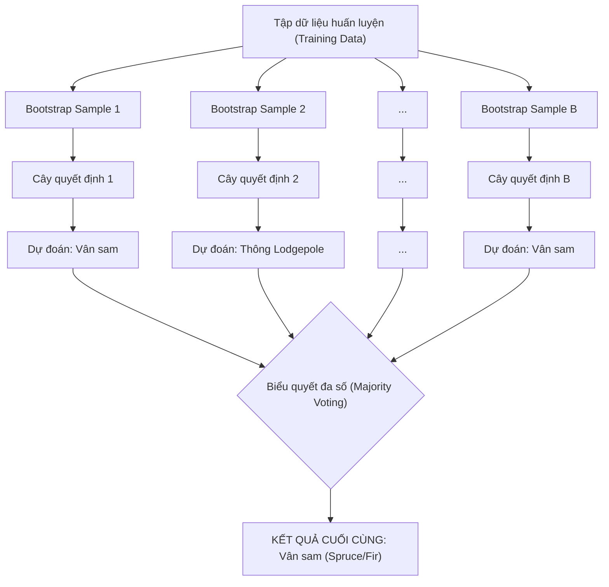

# TÀI LIỆU CƠ SỞ LÝ THUYẾT: THUẬT TOÁN RANDOM FOREST CLASSIFIER
## Đề tài: Phân loại kiểu thảm rừng từ dữ liệu địa hình (Forest Cover Type Classification)

> **Tài liệu tham chiếu liên quan**:
> - [Bối cảnh, Yêu cầu và Mục tiêu đề tài](../01_tong_quan_yeu_cau/BOI_CANH_YEU_CAU_MUC_TIEU.md)
> - [Kế hoạch triển khai kỹ thuật](../02_ke_hoach_va_kien_truc/KE_HOACH_TRIEN_KHAI.md)
> - [Danh mục tài liệu tham khảo & Dẫn chứng khoa học](../04_tai_lieu_tham_khao/TAI_LIEU_THAM_KHAO.md)

---

> **Trạng thái**: tài liệu lý thuyết cho dự án đang ở giai đoạn thiết kế; các nhận định về hiệu năng trên Covertype là **[KỲ VỌNG/GIẢ THUYẾT]**, chưa có số đo.

## 1. TỔNG QUAN VÀ NGUỒN GỐC THUẬT TOÁN

### 1.1. Lịch sử hình thành
**Random Forest (Rừng ngẫu nhiên)** là một trong những thuật toán học máy có giám sát (Supervised Learning) mạnh mẽ và phổ biến nhất hiện nay cho các bài toán phân loại (Classification) và hồi quy (Regression). 

Thuật toán được đề xuất chính thức bởi nhà thống kê học **Leo Breiman** (Đại học California, Berkeley) và **Adele Cutler** vào năm 2001 `[7]`. Random Forest được phát triển dựa trên sự kết hợp giữa hai ý tưởng đột phá:
1. **Bagging (Bootstrap Aggregating)** do chính Leo Breiman phát minh năm 1996 `[6]`.
2. **Phương pháp không gian con ngẫu nhiên (Random Subspace Method)** do Tin Kam Ho (Bell Labs) đề xuất năm 1998 `[8]`.

### 1.2. Triết lý "Trí tuệ tập thể" (Wisdom of the Crowds)
Thay vì dựa vào phán đoán của một mô hình đơn lẻ (dễ mắc sai lầm hoặc bị quá khớp), Random Forest xây dựng một **tập hợp (Ensemble)** gồm hàng trăm cây quyết định (Decision Trees) hoạt động độc lập.

Mỗi cây quyết định trong rừng đưa ra một dự đoán riêng. Sau đó, mô hình tổng hợp tất cả các kết quả này thông qua cơ chế **biểu quyết theo đa số (Majority Voting)** để đưa ra kết luận cuối cùng. Trực giác này giống Định lý Condorcet: *khi nhiều người ra quyết định **độc lập** với xác suất đúng > 50%, xác suất tập thể đúng tăng dần khi số người tăng.* Lưu ý: các cây trong Random Forest **không hoàn toàn độc lập** (chúng huấn luyện trên dữ liệu chồng lấn), nên lợi ích của việc thêm cây bị chặn bởi mức tương quan giữa các cây (xem công thức phương sai ở mục 3.3).

---

## 2. NỀN TẢNG: CÂY QUYẾT ĐỊNH (DECISION TREE)

Để hiểu sâu về Random Forest, trước hết cần nắm vững nguyên lý hoạt động của một cây quyết định đơn lẻ (thường sử dụng giải thuật CART - Classification and Regression Trees).

### 2.1. Cấu trúc cây
- **Nút gốc (Root Node)**: Chứa toàn bộ tập dữ liệu ban đầu.
- **Nút quyết định (Internal/Decision Nodes)**: Nơi dữ liệu bị phân nhánh dựa trên điều kiện kiểm tra một đặc trưng (ví dụ: `Độ cao Elevation > 2950m?`).
- **Nút lá (Leaf Nodes)**: Điểm kết thúc của nhánh cây, đại diện cho nhãn phân loại cụ thể (ví dụ: `Kiểu rừng = Krummholz`).

### 2.2. Tiêu chuẩn phân nhánh tối ưu: Độ vẩn đục Gini (Gini Impurity)
Tại mỗi nút phân nhánh, thuật toán CART tìm kiếm cặp `(đặc trưng, ngưỡng cắt)` sao cho sau khi chia, các nút con có độ tinh khiết cao nhất (các mẫu trong cùng một nút con thuộc về cùng một lớp).

Độ vẩn đục Gini tại nút $t$ được định nghĩa bằng công thức:

$$Gini(t) = 1 - \sum_{i=1}^{K} p_i^2$$

Trong đó:
- $K$ là tổng số lớp (trong đề tài này $K = 7$).
- $p_i$ là tỷ lệ số mẫu thuộc lớp $i$ tại nút $t$.

**Ý nghĩa**:
- $Gini = 0$: Nút hoàn toàn tinh khiết (100% các mẫu trong nút đều thuộc về duy nhất một lớp).
- $Gini$ càng cao: Dữ liệu trong nút bị pha trộn nhiều lớp khác nhau.

Mức giảm độ vẩn đục (Gini Gain / Impurity Reduction) khi chia tách nút cha $t$ thành hai nút con $t_L$ (trái) và $t_R$ (phải) là:

$$\Delta Gini(t) = Gini(t) - \left( \frac{N_L}{N} Gini(t_L) + \frac{N_R}{N} Gini(t_R) \right)$$

Thuật toán sẽ chọn đặc trưng và ngưỡng cắt có $\Delta Gini(t)$ lớn nhất để tiến hành phân nhánh.

### 2.3. Nhược điểm chí mạng của Cây quyết định đơn lẻ
- **Hiện tượng Quá khớp (Overfitting)**: Cây quyết định rất dễ phát triển quá sâu, "học vẹt" cả những nhiễu ngẫu nhiên trong dữ liệu huấn luyện.
- **Phương sai cao (High Variance)**: Cực kỳ nhạy cảm với dữ liệu. Chỉ cần thay đổi nhỏ trong tập huấn luyện (thêm hoặc bớt vài dòng), cấu trúc toàn bộ cây có thể bị biến đổi hoàn toàn.

---

## 3. CƠ CHẾ CỐT LÕI CỦA RANDOM FOREST: "HAI TẦNG NGẪU NHIÊN"

Random Forest giảm đáng kể nhược điểm High Variance của cây quyết định bằng cách áp dụng **hai kỹ thuật ngẫu nhiên hóa độc lập**:

### 3.1. Tầng 1: Lấy mẫu có hoàn lại (Bootstrap Aggregating - Bagging) `[6]`
- Với tập dữ liệu huấn luyện có $N$ mẫu, đối với mỗi cây thứ $b$ trong rừng ($b = 1, \dots, B$), thuật toán rút ngẫu nhiên $N$ mẫu từ tập gốc **có hoàn lại (with replacement)**.
- **Tính chất toán học**: Xác suất một mẫu bất kỳ không được chọn vào tập bootstrap của một cây là:
  $$\lim_{N \to \infty} \left( 1 - \frac{1}{N} \right)^N = \frac{1}{e} \approx 36.8\%$$
  Nghĩa là:
  - Khoảng **63.2%** số mẫu trong dữ liệu gốc sẽ xuất hiện trong tập huấn luyện của cây (một số mẫu lặp lại nhiều lần).
  - Khoảng **36.8%** số mẫu còn lại không được chọn, tạo thành tập **Out-Of-Bag (OOB)** của cây đó `[6, 7]`.
- Nhờ Bagging, mỗi cây quyết định được học trên một lát cắt dữ liệu khác nhau.

### 3.2. Tầng 2: Ngẫu nhiên hóa không gian đặc trưng (Feature Randomness) `[7, 8]`
- Trong một Cây quyết định thông thường, khi phân nhánh tại mỗi nút, nó sẽ quét qua **tất cả $p$ đặc trưng** để tìm đặc trưng tốt nhất. Nếu trong dữ liệu có 1 hoặc 2 đặc trưng chi phối áp đảo (ví dụ: `Độ cao Elevation`), hầu hết các cây đều sẽ chọn đặc trưng này ở nút gốc, khiến các cây trong rừng có cấu trúc rất giống nhau (tương quan cao).
- **Giải pháp của Random Forest**: Tại mỗi nút phân nhánh, thuật toán **chỉ chọn ngẫu nhiên một tập con gồm $m$ đặc trưng** ($m < p$) và chỉ tìm điểm cắt tối ưu trong số $m$ đặc trưng này.
- Với bài toán phân loại, một giá trị mặc định phổ biến (trong Scikit-learn và nhiều tài liệu hướng dẫn) là:
  $$m = \lfloor\sqrt{p}\rfloor$$
  Đây là **heuristic thực nghiệm, không phải kết quả đã được chứng minh là tối ưu**; có thể tinh chỉnh bằng siêu tham số `max_features`.
  *(Với Covertype gốc $p = 54$, `max_features='sqrt'` cho $m = \lfloor\sqrt{54}\rfloor = 7$; nếu số đặc trưng thay đổi sau khi tạo đặc trưng sinh thái, $m$ thay đổi theo.)*

### 3.3. Cơ chế Biểu quyết đa số (Majority Voting)
- Với một mẫu dữ liệu mới cần dự đoán $x$, mỗi cây $T_b$ sẽ đưa ra một phiếu bầu $\hat{C}_b(x) \in \{1, 2, \dots, K\}$.
- Dự đoán cuối cùng của cả khu rừng là lớp nhận được nhiều phiếu bầu nhất `[7]`:
  $$\hat{C}_{\text{RF}}(x) = \arg\max_{k \in \{1, \dots, K\}} \sum_{b=1}^{B} I\left(\hat{C}_b(x) = k\right)$$
  *(Trong đó $I(\cdot)$ là hàm chỉ thị nhận giá trị 1 nếu đúng, 0 nếu sai).*

> **Kết luận lý thuyết**: Việc kết hợp Bagging và Feature Randomness làm cho các cây trong rừng **rất đa dạng và không tương quan (de-correlated)**. Khi tính trung bình hoặc biểu quyết trên tập hợp các cây không tương quan, phương sai tổng thể giảm tỉ lệ thuận với số lượng cây:
> $$\text{Var}(\bar{X}) = \rho \sigma^2 + \frac{1 - \rho}{B} \sigma^2$$
> Khi giảm hệ số tương quan giữa các cây $\rho \to 0$ và số lượng cây $B$ đủ lớn, phương sai tổng thể giảm dần về sàn $\rho \sigma^2$ (không thể thấp hơn nếu các cây còn tương quan); độ chệch (Bias) của rừng về cơ bản tương đương từng cây đơn lẻ.

---

## 4. CÁC TÍNH NĂNG NÂNG CAO TRONG RANDOM FOREST

### 4.1. Đánh giá lỗi Out-of-Bag (OOB Error Score)
- Vì mỗi cây chỉ học trên ~63.2% dữ liệu, nên 36.8% dữ liệu OOB của mỗi cây đóng vai trò như một tập kiểm thử tự nhiên (Validation set) `[7]`.
- Để đánh giá một mẫu $x_i$, ta chỉ thu thập dự đoán từ những cây mà trong tập huấn luyện của chúng **không chứa $x_i$**.
- **Lợi ích**: Mô hình có thể tự đánh giá hiệu năng tổng quát (Generalization Error) trực tiếp trong quá trình huấn luyện mà **không cần phải cắt xén một tập Validation riêng**.

### 4.2. Đo lường tầm quan trọng của đặc trưng (Feature Importance)
Random Forest cung cấp phương pháp định lượng mức độ đóng góp của từng đặc trưng vào việc phân loại thông qua chỉ số **Mean Decrease Impurity (MDI)** `[7]`:
1. Mỗi khi một đặc trưng $X_j$ được chọn để phân nhánh tại một nút, ta ghi nhận mức giảm độ vẩn đục $\Delta Gini$ tại nút đó.
2. Tầm quan trọng của $X_j$ trên một cây là tổng mức giảm $\Delta Gini$ của tất cả các nút sử dụng $X_j$.
3. Tầm quan trọng của $X_j$ trong toàn bộ khu rừng là giá trị trung bình trên tất cả $B$ cây:
   $$Importance(X_j) = \frac{1}{B} \sum_{b=1}^{B} \sum_{t \in T_b, v(t) = X_j} \Delta Gini(t)$$
4. Điểm số này sau đó được chuẩn hóa sao cho tổng điểm của tất cả các đặc trưng bằng 1 (hoặc 100%).

> **Lưu ý**: MDI có thể thiên lệch (ví dụ ưu ái biến liên tục/nhiều mức) và chia nhỏ điểm giữa các biến tương quan cao (như `Elevation` và `Elevation_water`) `[15]`. Dự án báo cáo thêm **Permutation Importance** (trên tập kiểm thử) để đối chiếu.

### 4.3. Xử lý mất cân bằng dữ liệu (`class_weight='balanced'`)
Trong các bộ dữ liệu thực tế như Forest Covertype, phân bố lớp bị lệch nghiêm trọng (Lớp 1 & 2 chiếm 85.22%, trong khi Lớp 4 chỉ 0.47% `[1, 3]`). 

Một cách xử lý phổ biến là gán trọng số lớp $w_k$ tỉ lệ nghịch với số mẫu của lớp $k$ (heuristic `'balanced'` của Scikit-learn `[14]`):

$$w_k = \frac{N}{K \times n_k}$$

- $N$: Tổng số mẫu trong tập huấn luyện.
- $K$: Số lớp mục tiêu ($K = 7$).
- $n_k$: Số lượng mẫu của lớp $k$.

Trên tập huấn luyện của dự án (≈ 69.721 mẫu; lớp 4 ≈ 330 mẫu), trọng số một mẫu Lớp 4 gấp khoảng $77$ lần Lớp 1 và khoảng $103$ lần Lớp 2. Kỳ vọng điều này khiến cây ưu tiên các điểm cắt bảo vệ lớp hiếm, tăng Recall/F1 của lớp thiểu số **[GIẢ THUYẾT]**; nhưng trọng số có thể làm giảm Precision và với Random Forest lợi ích đôi khi nhỏ. Cần so sánh `None`, `'balanced'` và `'balanced_subsample'` (tính trọng số lại trên từng mẫu bootstrap) bằng ablation.

---

## 5. BẢNG CÁC SIÊU THAM SỐ (HYPERPARAMETERS) CẦN QUAN TÂM TRONG SCIKIT-LEARN

Khi sử dụng `sklearn.ensemble.RandomForestClassifier`, các tham số quan trọng cần tinh chỉnh bao gồm:

| Tham số | Ý nghĩa kỹ thuật | Ảnh hưởng / Khuyến nghị |
| :--- | :--- | :--- |
| `n_estimators` | Số lượng cây trong rừng (mặc định = 100). | Tăng số cây giúp mô hình ổn định hơn, giảm phương sai sai số. Khuyến nghị: `100 - 150` cây để cân bằng giữa độ chính xác và thời gian chạy Colab. **[SỐ ĐO]** (Bước 9): Macro-F1 trên D_val tăng 0,0010 từ 150 lên 300 cây (nhỏ hơn 1 SD giữa các seed); chọn 150. |
| `criterion` | Hàm đo lường chất lượng phân nhánh: `'gini'` hoặc `'entropy'`. | `'gini'` tính toán nhanh hơn và thường cho kết quả tương đương. **[SỐ ĐO]** (E5): trên dữ liệu này `'entropy'` cho Macro-F1 cao hơn `'gini'` ở cả 4 mức `max_features` thử nghiệm (+0,001 đến +0,005), thời gian huấn luyện tương đương. |
| `max_depth` | Độ sâu tối đa của mỗi cây quyết định. | Khống chế độ sâu (`max_depth = 15 - 25`) giúp hạn chế overfitting và giảm dung lượng bộ nhớ. **[SỐ ĐO]** (E4): ở mọi quy mô thử nghiệm, `max_depth=None` cho Macro-F1 cao hơn `max_depth=20` (0,943 so với 0,900 ở 348.608 mẫu, chia ngẫu nhiên). Ngược lại, `max_depth=20` cho Recall lớp 4 và lớp 5 cao hơn, đổi lại Precision thấp hơn (lớp 5: Recall 0,970, Precision 0,628). |
| `min_samples_split` | Số lượng mẫu tối thiểu tại một nút để cho phép chia nhánh tiếp (mặc định = 2). | Tăng giá trị này (ví dụ lên 5 hoặc 10) giúp cây khái quát hóa tốt hơn, tránh tạo ra các nút quá nhỏ chứa nhiễu. |
| `min_samples_leaf` | Số lượng mẫu tối thiểu bắt buộc phải có tại một nút lá (mặc định = 1). | Đặt giá trị 2 hoặc 4 giúp làm mượt biên quyết định, giảm thiểu ảnh hưởng của các điểm ngoại lai. |
| `max_features` | Số lượng đặc trưng ngẫu nhiên xem xét tại mỗi nút phân nhánh. | `'sqrt'` (mặc định: $m = \lfloor\sqrt{p}\rfloor$) là mặc định phổ biến cho phân loại; có thể tinh chỉnh. **[SỐ ĐO]** (E5, 57 cột): `0.35` + entropy cho Macro-F1 cao nhất trong lưới {sqrt, 0.35, 0.5, 0.7}; mô hình cuối dùng `0.35`. |
| `class_weight` | Cơ chế điều chỉnh trọng số các lớp. | Khởi điểm `'balanced'` để tăng trọng số lớp hiếm; so sánh với `None` và `'balanced_subsample'` bằng ablation. **[SỐ ĐO]**: `'balanced'` cho F1 cao nhất trên mẫu 87K (E1), nhưng `None` cao hơn khi huấn luyện trên 348K mẫu (E5); lựa chọn phụ thuộc quy mô dữ liệu. |
| `n_jobs` | Số lõi CPU sử dụng song song để huấn luyện. | Đặt `-1` để khai thác tối đa tất cả các nhân CPU có sẵn trên môi trường Google Colab. |
| `random_state` | Hạt giống sinh số ngẫu nhiên. | Đặt một số nguyên cố định (ví dụ: `42`) để kết quả có tính tái lập (reproducible). |

---

## 6. SO SÁNH ƯU ĐIỂM VÀ NHƯỢC ĐIỂM

### 6.1. Ưu điểm nổi bật
1. **Độ chính xác cao**: Theo so sánh thực nghiệm trên nhiều bộ dữ liệu của Caruana & Niculescu-Mizil `[9]`, Random Forest thường thuộc nhóm thuật toán dẫn đầu cho dữ liệu dạng bảng (đây là nhận định chung, không phải số liệu riêng cho Covertype).
2. **Kháng Overfitting mạnh mẽ**: Việc tăng số lượng cây không làm mô hình bị quá khớp thêm, giúp người dùng an tâm khi huấn luyện `[7]`.
3. **Không cần chuẩn hóa dữ liệu khắt khe**: Vì cây phân nhánh dựa trên phép so sánh lớn hơn/nhỏ hơn (`>` hoặc `<`), thuật toán hoàn toàn miễn nhiễm với sự khác biệt về thang đo giữa các biến (ví dụ: Độ cao hàng nghìn mét so với Góc dốc vài chục độ).
4. **Học được quan hệ phi tuyến và tương tác đa chiều**: Tự động nắm bắt các tổ hợp điều kiện phức tạp mà các mô hình tuyến tính (như Logistic Regression) không thể làm được.
5. **Cung cấp chỉ số diễn giải**: Cho phép xuất bảng Feature Importance (nên đối chiếu thêm Permutation Importance, xem mục 4.2).

### 6.2. Hạn chế và Cách khắc phục trong đề tài
1. **Tính chất "Hộp đen" tương đối (Black-box)**: Khó có thể vẽ toàn bộ 200 cây lên một trang giấy để xem xét từng nhánh.
   - *Khắc phục trong đề tài*: Huấn luyện một Cây quyết định nông làm mô hình đại diện (surrogate) **trên dự đoán của Random Forest** để trích xuất quy tắc If-Then, và báo cáo Fidelity so với RF (xem `PHUONG_PHAP_TRICH_XUAT_LUAT.md`). Luật chỉ là xấp xỉ của RF.
2. **Tốn bộ nhớ RAM hơn cây đơn lẻ**: Lưu trữ hàng trăm cây yêu cầu dung lượng bộ nhớ lớn hơn.
   - *Khắc phục trong đề tài*: Dùng lấy mẫu phân tầng 15% (~87.000 dòng) cho pha thử nghiệm và giới hạn `max_depth`; mức RAM/thời gian thực tế **[CẦN ĐO]**, và kích thước mẫu cuối chọn bằng learning curve.

---

## 7. LÝ DO CHỌN RANDOM FOREST CHO ĐỀ TÀI FOREST COVERTYPE

1. **Phù hợp với bản chất dữ liệu**: Bộ dữ liệu UCI 31 `[1]` chứa 54 cột kết hợp cả biến số liên tục (độ cao, khoảng cách) và biến nhị phân One-hot (loại đất, vùng hoang dã). Random Forest xử lý sự pha trộn này khá tự nhiên.
2. **Phản ánh chính xác phân tầng sinh thái học**: Cây cối trong tự nhiên phân bố theo các "túi vi khí hậu" phi tuyến tính theo nghiên cứu của Peet `[4]` và Marr `[5]`. Mô hình cây phân nhánh phù hợp để mô tả kiểu phân tầng này.
3. **Cơ chế `class_weight` hỗ trợ lớp thiểu số**: Kỳ vọng giúp loài cây hiếm *Cottonwood/Willow* (chỉ chiếm 0.47% `[1, 3]`) không bị lấn át bởi hai loài chiếm 85% diện tích rừng; hiệu quả được kiểm chứng bằng ablation **[GIẢ THUYẾT]**.
